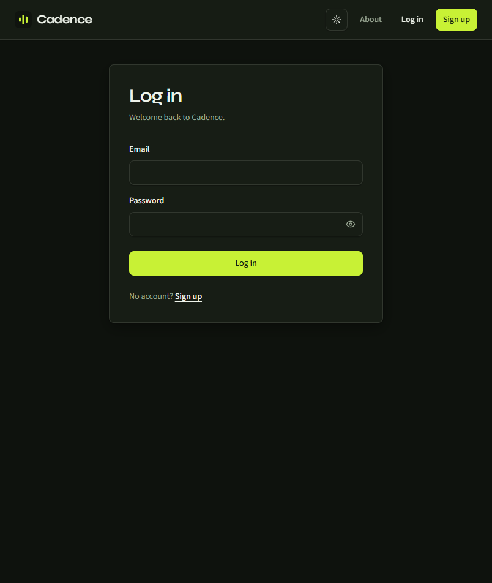
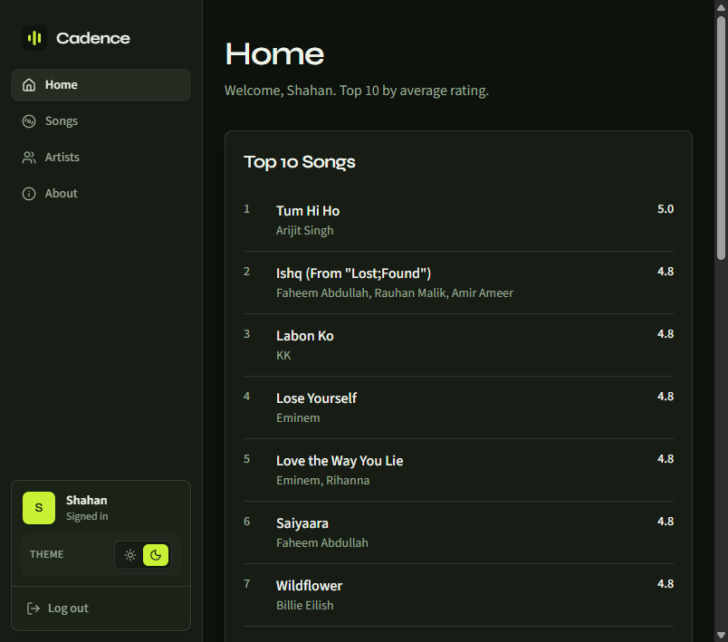
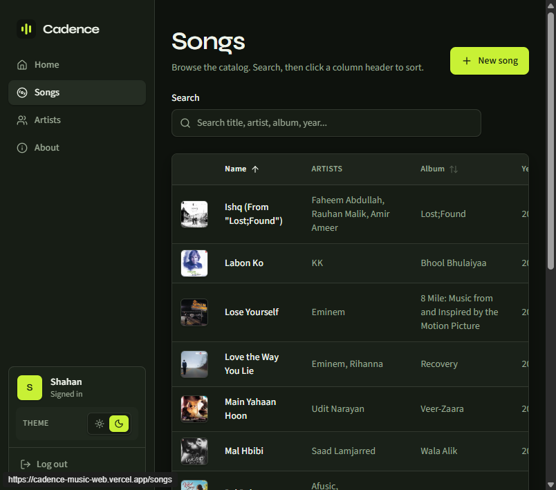
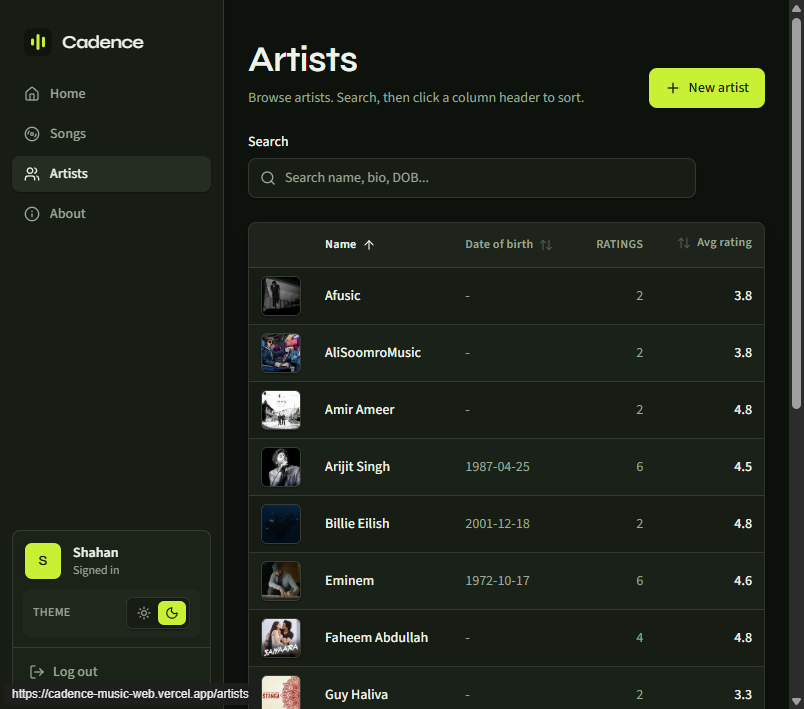
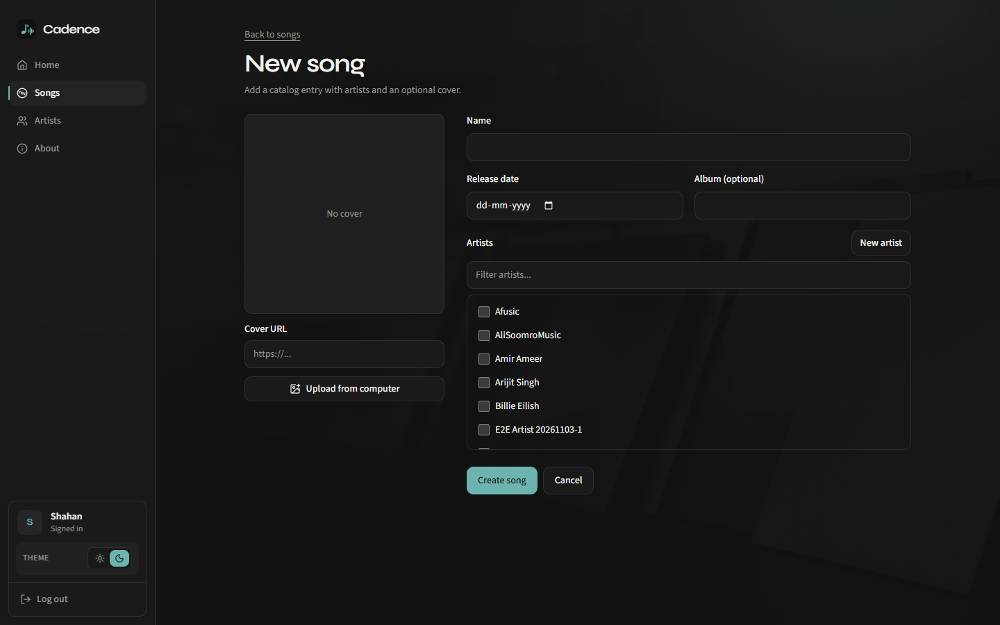
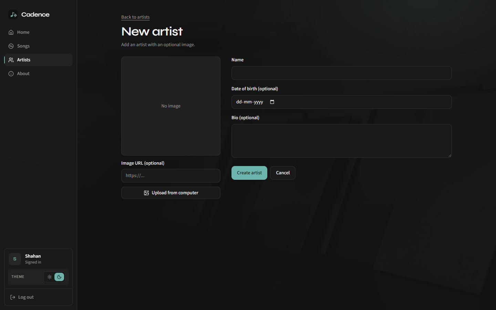

# Cadence

Personal full-stack **music catalog** - rate songs, rank artists, add covers. Portfolio rebuild of a classic catalog brief (not coursework).

**Live**

|        | URL                                                                                          |
| ------ | -------------------------------------------------------------------------------------------- |
| Web    | [https://cadence-music-web.vercel.app](https://cadence-music-web.vercel.app)                 |
| API    | [https://cadence-api-z3vh.onrender.com](https://cadence-api-z3vh.onrender.com)               |
| Health | [https://cadence-api-z3vh.onrender.com/health](https://cadence-api-z3vh.onrender.com/health) |

## Screenshots

### Login



### Home (Top 10)



### Songs



### Artists



### New song



### New artist



> If images are missing locally, pull latest or re-capture from the live site after login.

## Features

- **Auth** - Register and login (name + email); JWT sessions; protected catalog routes
- **Home** - Top 10 songs and Top 10 artists by average rating
- **Songs catalog** - Full list with search and sort (name, rating, release year, album); song detail with cover, artists, averages
- **Rate songs** - Per-user ratings 1–5 (decimals OK); upsert on song detail; multi-user averages
- **New song** - Create with name, release date, optional album/cover; multi-select artists; ImageKit upload or URL
- **Artists catalog** - Full list with search and sort (name, rating, DOB); artist detail with bio, image, linked songs
- **New artist** - Create with name, optional DOB / bio / image (upload or URL); usable from the New Song flow
- **Image editing** - Update song covers and artist images from detail pages (ImageKit signed uploads)
- **UI** - Light/dark theme; mobile responsive; skeleton loaders; empty/error states; toasts (Sonner)
- **About** - Project about page
- **API + DB** - Express REST + Prisma on MySQL/TiDB; normalized users, artists, songs, song_artists, ratings; migrations + seed
- **Quality / ship** - TypeScript strict (no `any`); ESLint + Prettier + Husky; CI; live on Vercel + Render; Telegram deploy notify

## Stack

| Layer    | Choice                                               |
| -------- | ---------------------------------------------------- |
| Language | TypeScript strict (**no `any`**)                     |
| Monorepo | `apps/web` + `apps/api` + `packages/shared`          |
| Web      | Vite + React + Tailwind + Axios + RHF + Zod + Sonner |
| API      | Express + Prisma 7 + Zod                             |
| DB       | MySQL / **TiDB Cloud**                               |
| Images   | ImageKit (signed upload; private key on API only)    |
| Hosting  | Web → **Vercel**; API → **Render**                   |

## Repo layout

```text
apps/web           # Vite React → Vercel
apps/api           # Express Prisma → Render
packages/shared    # Shared Zod (password rules)
docs/              # ERD, schema, architecture
```

## Prerequisites

- Node.js 20+
- TiDB `DATABASE_URL` for local API
- Optional: ImageKit keys for uploads / seed images

## Setup

```bash
npm install
cp apps/api/.env.example apps/api/.env
cp apps/web/.env.example apps/web/.env
npm run prisma:generate -w cadence-api
npm exec -w cadence-api -- prisma migrate deploy
npm run prisma:seed -w cadence-api   # optional demo data
```

## Environment variables

### API (`apps/api/.env` / Render)

| Variable                | Purpose                                 |
| ----------------------- | --------------------------------------- |
| `DATABASE_URL`          | TiDB MySQL URL (`?sslaccept=strict`)    |
| `JWT_SECRET`            | JWT signing (≥16 chars)                 |
| `JWT_EXPIRES_IN`        | Optional; default `7d`                  |
| `IMAGEKIT_PUBLIC_KEY`   | ImageKit                                |
| `IMAGEKIT_PRIVATE_KEY`  | ImageKit (**API only**)                 |
| `IMAGEKIT_URL_ENDPOINT` | CDN base (no media folder suffix)       |
| `IMAGEKIT_FOLDER`       | Upload folder; default `/cadence`       |
| `CORS_ORIGIN`           | Allowed web origin (Vercel URL in prod) |
| `PORT`                  | Local default `4000`; Render sets this  |
| `NODE_ENV`              | `development` / `production`            |

### Web (`apps/web/.env` / Vercel)

| Variable       | Purpose                                 |
| -------------- | --------------------------------------- |
| `VITE_API_URL` | Public API base (**no trailing slash**) |

Never commit real `.env` files or private keys.

## Develop

```bash
npm run dev:api   # http://localhost:4000
npm run dev:web   # http://localhost:5173
```

## Quality

```bash
npm run lint
npm run format:check
npm run typecheck
npm test
```

Pre-commit (Husky → lint-staged): em-dash fix, ESLint `--fix`, Prettier.

## Demo login (seed)

After `prisma db seed`:

| Email                | Password     |
| -------------------- | ------------ |
| `shahan@cadence.com` | `Shahan@123` |
| `admin@cadence.com`  | `Admin@123`  |

## Validations

Documented rules enforced on web and/or API (Zod):

| Area                  | Rules                                                                                                                          |
| --------------------- | ------------------------------------------------------------------------------------------------------------------------------ |
| **Register password** | 8–24 chars; ≥1 upper, ≥1 lower, ≥1 number, ≥1 symbol (`@cadence/shared` `passwordSchema`). Web validates first; API re-checks. |
| **Login password**    | Non-empty; verified against bcrypt hash                                                                                        |
| **Email**             | Required, unique (`409` if taken)                                                                                              |
| **Artist create**     | Name required (max 150); optional DOB / bio / image URL; duplicate name → `409 ARTIST_NAME_TAKEN`                              |
| **Song create**       | Name, release date (`YYYY-MM-DD`), ≥1 artist; optional album / cover; same title + same artist set → `409 SONG_DUPLICATE`      |
| **Rating**            | 1–5 inclusive; decimals OK; upsert per user+song                                                                               |
| **Image URLs**        | Valid URL, max 2048 chars when set                                                                                             |

## Catalog rules

Uniqueness for artists/songs is enforced in the **API** (not hard DB uniques on names), so rules can evolve.

- Artists may exist with zero songs.
- Songs require at least one artist.
- DB structural uniques: `users.email`, `ratings (user_id, song_id)`, `song_artists` composite PK.

**Averages:** song = `AVG` of its ratings; artist = average of all ratings on that artist’s songs.

## Deploy (summary)

1. **Render** - root install/build `cadence-api`; set API env; `CORS_ORIGIN=https://cadence-music-web.vercel.app`
2. **Vercel** - Root `apps/web`; install/build from monorepo root (`cd ../.. && …`); `VITE_API_URL` = Render URL

Optional: GitHub secrets `TELEGRAM_BOT_TOKEN` / `TELEGRAM_CHAT_ID` for [deploy notify](.github/workflows/vercel-deploy-notify.yml).

## Coming soon

- Lyrics on song detail (placeholder live)
- Search on Home
- Flexible artist identity (e.g. name + DOB + nationality)
- Spotify / full audio player
- GraphQL (optional; REST is primary)

## Documentation

| Doc                                                  | Contents                        |
| ---------------------------------------------------- | ------------------------------- |
| [`docs/erd.md`](docs/erd.md)                         | ER diagram                      |
| [`docs/database-schema.md`](docs/database-schema.md) | Tables, FKs, indexes            |
| [`docs/architecture.md`](docs/architecture.md)       | Topology, auth, uploads, deploy |
| [`AGENTS.md`](AGENTS.md)                             | Agent / contributor conventions |
