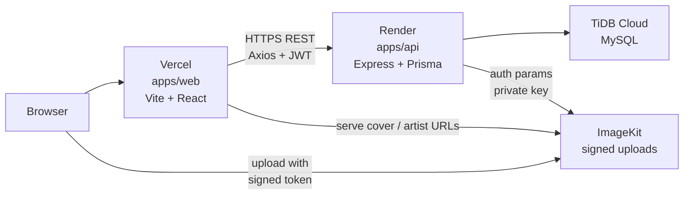
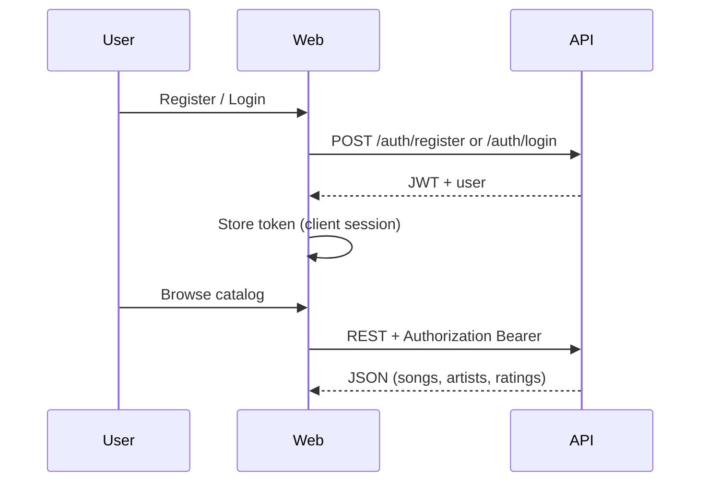

# Cadence - Architecture

Personal music catalog: rate songs, rank artists, manage covers/images.

## Live environments

| Layer        | URL                                                                                          |
| ------------ | -------------------------------------------------------------------------------------------- |
| Web (Vercel) | [https://cadence-music-web.vercel.app](https://cadence-music-web.vercel.app)                 |
| API (Render) | [https://cadence-api-z3vh.onrender.com](https://cadence-api-z3vh.onrender.com)               |
| API health   | [https://cadence-api-z3vh.onrender.com/health](https://cadence-api-z3vh.onrender.com/health) |
| Images       | ImageKit CDN (`IMAGEKIT_URL_ENDPOINT` + folder `/cadence`)                                   |
| Database     | TiDB Cloud (MySQL protocol)                                                                  |

## High-level topology



## Monorepo layout

```text
cadence/
├── apps/web          # Vite React TS → Vercel
├── apps/api          # Express Prisma TS → Render
├── packages/shared   # Shared Zod (e.g. passwordSchema)
├── docs/             # This documentation pack
└── .github/workflows # CI + Vercel deploy notify
```

`@cadence/shared` is an npm workspace package. Deploy installs from the **repo root** so workspaces resolve.

## Auth flow



- Register: name, email, password (shared Zod rules).
- Login: email + password; JWT signed with `JWT_SECRET`.
- Protected catalog routes use `requireAuth`.

## Image uploads

1. Authenticated client requests upload auth from API (`/uploads/...`).
2. API signs with ImageKit **private** key (never on Vercel).
3. Browser uploads directly to ImageKit into `IMAGEKIT_FOLDER` (default `/cadence`).
4. Resulting CDN URL is saved on song `cover_url` or artist `image_url`.

## Ratings

- Upsert: `POST /songs/:id/ratings` with value 1–5 (decimals OK).
- Song detail returns `myRating` for the signed-in user.
- Home shows Top 10 averages only (rate/edit on song detail).

## CI / notify

- **CI** (`.github/workflows/ci.yml`): lint + test web and API on PR/push.
- **Deploy notify** (`.github/workflows/vercel-deploy-notify.yml`): optional Telegram / Discord when Vercel deploy succeeds (needs GitHub secrets).

## Local vs production

|                | Local                       | Production    |
| -------------- | --------------------------- | ------------- |
| Web            | `npm run dev:web` → `:5173` | Vercel        |
| API            | `npm run dev:api` → `:4000` | Render        |
| `VITE_API_URL` | `http://localhost:4000`     | Render origin |
| `CORS_ORIGIN`  | `http://localhost:5173`     | Vercel origin |

## Related docs

- [`erd.md`](erd.md)
- [`database-schema.md`](database-schema.md)
- [`../README.md`](../README.md)
