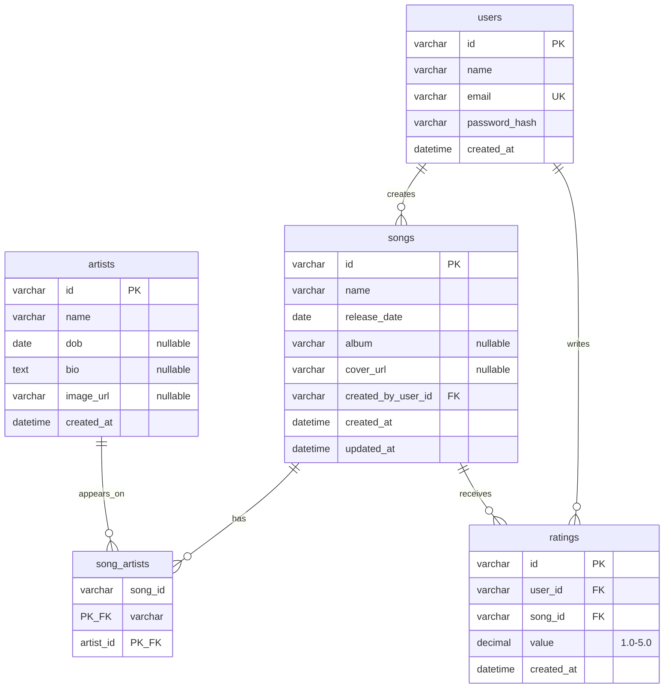

# Cadence - Entity Relationship Diagram

Normalized MySQL / TiDB schema used by Prisma (`apps/api/prisma/schema.prisma`).

**Live API:** [https://cadence-api-z3vh.onrender.com/health](https://cadence-api-z3vh.onrender.com/health)  
**Live web:** [https://cadence-music-web.vercel.app](https://cadence-music-web.vercel.app)

## Mermaid ERD

## Cardinalities

| Relation      | Cardinality | Notes                                                       |
| ------------- | ----------- | ----------------------------------------------------------- |
| User → Song   | 1 : N       | Creator of the catalog row (`created_by_user_id`)           |
| User → Rating | 1 : N       | One rating per user per song (`@@unique([userId, songId])`) |
| Song ↔ Artist | N : M       | Via `song_artists`                                          |
| Song → Rating | 1 : N       | Average = `AVG(ratings.value)`                              |

## Rating / average rules

- **Song average:** mean of all `ratings.value` for that song.
- **Artist average:** mean of all ratings on songs linked to that artist (flat pool of rating rows, not avg-of-song-avgs).
- Range **1–5** with decimals allowed; enforced in Zod / API (not a DB CHECK).

## Uniqueness (API vs DB)

| Rule                         | Where                                               |
| ---------------------------- | --------------------------------------------------- |
| `users.email`                | DB unique                                           |
| One rating per user+song     | DB unique                                           |
| Song↔artist pair             | Composite PK on `song_artists`                      |
| Artist name uniqueness       | **API** (`409 ARTIST_NAME_TAKEN`) - not a DB unique |
| Song title + same artist set | **API** (`409 SONG_DUPLICATE`)                      |

See also [`database-schema.md`](database-schema.md) and [`architecture.md`](architecture.md).
